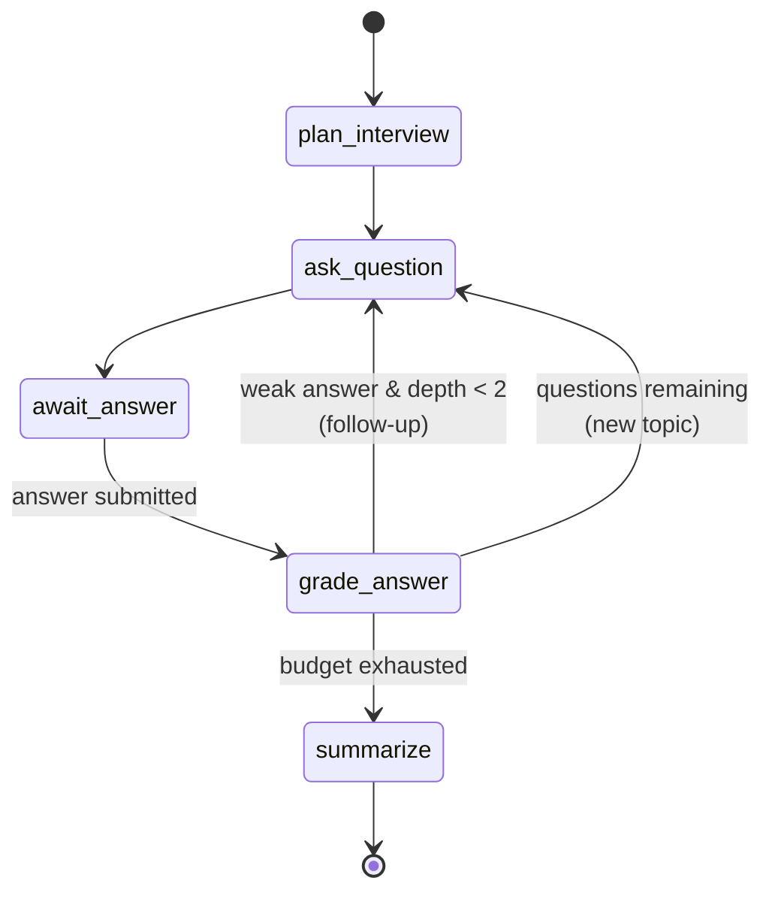

# Mettle

### ▶ [Try it live](https://skull94.github.io/mettle/) · [API health](https://mettle-api-jd5q.onrender.com/healthz)

**AI mock interviews for mobile/Flutter engineers.** Pick a topic, get interviewed by an agent that
probes deeper when an answer is thin, and get a rubric-scored breakdown with your progress tracked
over time.

Flutter app (Web · Android · iOS) + FastAPI/LangGraph backend in one repo.

**Flutter web is the current priority — the mobile builds are on hold.** The deployed web app is
what's actively developed and the only surface you can try without cloning. Android and iOS build
from the same codebase and still compile, but are paused until the web experience is finished.

> The differentiator is **measurement, not chat**. Anything can ask questions. This scores answers
> against a fixed rubric and shows the trend across sessions.

<!-- Demo GIF goes here — M1 is complete, so this is the next thing to add. Record on a real phone:
     pick topic → question streams in → answer → follow-up fires → scorecard. -->

---

## 🚧 Status

**In active development — M1 complete, M2 down to the Pro plan.** The sections below mark what is
implemented versus planned, so nothing here overstates what you'll find if you clone it.

| Milestone | Scope | Status |
|---|---|---|
| **M1** | Splash · Home · Interview · Scorecard · Progress (basic) · Settings (basic). Text only, difficulty-tiered topics, end to end | ✅ Complete |
| **M2** | **Auth (Google + email) ✅** · Supabase-backed session history ✅ · **Supabase Postgres store ✅** · **redesigned dashboard + web shell ✅** · **verbatim question bank ✅** · Pro plan | 🚧 Pro plan only |
| **M3** | Multi-stack catalogues · onboarding (stack · experience · focus) · JD-targeted questions · progress filters · checkpointer resume · human-in-the-loop · voice answers + waveform · **deployed web build ✅** | 🚧 Started |

---

## Phase 1 scope

One repo, two deployable apps, one working vertical slice between them.

**Definition of done:** a full interview — question, answer, follow-up, scorecard — end to end
against a live model. Verified on an Android device over Wi-Fi driving the containerised backend.

| | Ships in Phase 1 |
|---|---|
| **`app/`** | Splash → Dashboard → Interview → Scorecard, plus basic Progress and Settings. Text only, responsive, all four states on every screen. |
| **`api/`** | The versioned SSE event protocol, the five-node graph with the conditional follow-up edge, the checkpointer, the topic catalogue and the provider adapter. |
| **The seam** | The SSE protocol is the contract; the Dart `TurnEvent` sealed class is its client-side shape. Both halves live in one repo, so a protocol change is one commit. |
| **CI/CD** | One workflow: analyze, build the web bundle, publish to Pages on every push to `main`. The API deploys from the same push via `render.yaml`. |

**Out of scope:** voice input · question coverage · progress filters · notifications · role/JD
onboarding · iOS device testing · running without an API key.

---

## Platform support

| Target | Status | Notes |
|---|---|---|
| **Web** | ✅ **Primary** — [live](https://skull94.github.io/mettle/) | Deployed from CI on every push to `main` |
| **Android** | ⏸️ **On hold** | Developed and run on a real device through M2 |
| **iOS** | ⏸️ **On hold** | Never device-tested — I develop on Windows, and iOS needs macOS and Xcode. No CI job compiles it yet |
| Desktop | ❌ Not a target | |

---

## Auth

Supabase-backed: Google and email/password, password reset, and a remember-this-device toggle.
Splash checks for an existing session and routes to Sign-in or Dashboard. With Supabase configured,
session history persists there; without it the app falls back to local storage.

It shipped *after* the interview loop, deliberately. Identity started device-local, so sessions and
scores worked before there was an account to attach them to — and that time went to the streaming
UI, the agent graph and the scoring rubric instead.

**Sign-in is required by design** — there is no anonymous mode. Scores and progress are tied to an
account, so an interview without one has nothing to attach to.

---

## What it does

| Screen | Purpose |
|---|---|
| **Splash** | Async bootstrap — DI, Supabase, prefs, device id — then routes to Sign-in or Dashboard |
| **Sign-in** | Google and email/password, sign-up, password reset, remember-this-device |
| **Dashboard** | Three states from `GET /v1/me/summary`: first visit, returning (recommended topic, readiness ring, recent interviews), and free-limit-reached |
| **Brief** | Pre-interview confirmation — topic, level, question count, duration |
| **Interview** | The core loop: streaming questions, `Q 3 of 5` progress, and a **`↳ FOLLOW-UP`** badge when the agent probes deeper instead of advancing |
| **Scorecard** | Rubric scores (correctness · depth · clarity · structure), overall ring, what was missing |
| **History** | Finished interviews grouped by month; any row opens its scorecard |
| **Progress** | Score trend across the last 10 sessions, topic mastery rows |
| **Settings** | Appearance, clear stored data, app version. Reached from the account menu |

Every screen implements all four states — loading, empty, error, loaded — not just the happy path.
Skeletons, never centered spinners.

---

## Architecture — Flutter app

**Clean Architecture** with a strict dependency rule: `presentation → domain ← data`. The domain
layer imports nothing from `data`, `presentation`, or Flutter itself. Enforced in review — the CI
guard for it is still to be written.

```
lib/
├── core/           constants · theme · error · network · router · di · result · storage · platform · widgets
└── features/<feature>/
    ├── data/           models · datasources · repositories (impl)
    ├── domain/         entities · repository contracts · use cases
    └── presentation/   bloc · pages · widgets
```

| Concern | Choice |
|---|---|
| State management | `flutter_bloc` — one bloc per feature, sealed states, `Cubit` where there are no meaningful events |
| Dependency injection | `get_it`, manual registration in one file — explicit and greppable, no codegen |
| Navigation | `go_router`, flat routes; the sidebar/bottom-nav chrome is a widget (`AppScaffold` + `ShellHost`), not a `StatefulShellRoute` |
| Error handling | A hand-rolled sealed `Result<T>` + Dart 3 pattern matching — no `dartz`, no extra dependency |
| Theming | Material 3 light + dark from one seed, plus the Mettle design-token layer (`MettleColors` as a `ThemeExtension`, `MettleText`, `MettleSpace`, `SizeClass`) that the dashboard and shell are built on |

Two conventions worth calling out, both documented in [`CONVENTIONS.md`](CONVENTIONS.md):

- **No `build_runner` codegen** — no `freezed`, `injectable`, or `json_serializable` while the app is
  small. Dart 3 sealed classes cover it without a build step. This was the single biggest lever on
  keeping the codebase pleasant to work in.
- **`Page` / `View` split** — `*Page` is the route boundary that reads DI and provides the bloc;
  `*View` is pure UI with no dependencies, which keeps DI out of the widget tree. `sl<T>()` appears
  in exactly one place per feature.

---

## Architecture — backend

FastAPI + LangGraph. **The graph is the product**: an interview is a genuine state machine, which is
why LangGraph earns its place here rather than being bolted onto a single prompt.



Three LangGraph features, each doing real work:

- **A conditional edge** routes on grade — probe deeper on a weak answer (capped at depth 2), else
  advance, else summarize. It's about six lines, and it's the thing worth reading in the whole repo.
- **`interrupt()`** parks the graph while waiting for the user's answer.
- **A checkpointer** (SQLite → Postgres) persists state, so a session resumes days later.

That routing decision travels to the client as a first-class SSE event, which is what makes the
`↳ FOLLOW-UP` badge in the UI truthful rather than cosmetic.

### HTTP surface

```
POST   /v1/sessions                     create a session
GET    /v1/sessions/{id}                current session state
GET    /v1/sessions/{id}/turns/stream   SSE — question tokens + grade events
POST   /v1/sessions/{id}/answer         submit an answer (idempotent on turn_id)
POST   /v1/sessions/{id}/skip           skip the current question
GET    /v1/sessions/{id}/scorecard      final scorecard
DELETE /v1/sessions/{id}                delete a session
GET    /v1/me/summary                   dashboard payload — plan · free credits · readiness ·
                                        topic statuses · recent interviews · recommended next
GET    /v1/topics                       topic catalogue
GET    /v1/meta                         version · model · configured
GET    /healthz                         liveness — backend · model · configured
```

**Free credits are spent on first submission, not on session create** — answering or skipping the
first question books the credit, so abandoning a brief costs you no interviews. The monthly spend
estimate is reserved up front at create, though, so an abandoned brief still counts against the cap.

Answer submission and streaming are **separate calls** on purpose: a POST returning
`text/event-stream` is more elegant, but `EventSource` on the web is GET-only, and web is a primary
target. Two cheap round-trips beat a platform-specific transport.

### The provider seam

The model sits behind an `LLMProvider` protocol — `stream_question` and `grade` — so the graph never
imports the SDK and knows nothing about which model answers. Swapping models is one env var, and the
provider adapts to each model's capabilities: `effort` and adaptive thinking go to models that
support them, and are dropped for anything in `NO_TUNING_PREFIXES` (Haiku 4.5, Sonnet 4.5), which
rejects both.

**There is one implementation, and it needs a key.** An earlier design had a second, scripted
provider reading from a checked-in question bank so the repo would run with no credentials. That was
dropped once topics became difficulty-tiered: a hand-written bank covering 21 topics across three
levels would have been large, stale, and graded by keyword matching far weaker than the rubric. The
tradeoff is deliberate and it has a real cost — a reviewer cannot run this without their own key.

---

## Deployment

Three free services, no card on file anywhere. Full runbook in [`docs/deploy.md`](docs/deploy.md).

| Piece | Host | Why there |
|---|---|---|
| Flutter web build | **GitHub Pages** — [skull94.github.io/mettle](https://skull94.github.io/mettle/) | Static files; a CDN, not a server |
| FastAPI + LangGraph | **Render** free web service | Needs a live process holding SSE connections |
| Postgres · auth · checkpoints | **Supabase** | Render's free Postgres expires 30 days after creation |
| Keep-alive ping | **cron-job.org** → `/healthz` every 10 min | Free instances sleep after 15 idle minutes |

`git push` to `main` deploys both halves. `.github/workflows/web.yml` analyzes, builds and publishes
to Pages; `render.yaml` describes the API as a Docker service with `/healthz` as its health check,
and Render rebuilds on the same commit.

Two things the deployment forces that are worth knowing before reading the code:

- **One instance, one worker.** The per-session mailbox is process memory, so a second worker would
  break the answer/stream pairing. Redis pub/sub is the fix when it's needed; the Postgres
  checkpointer already covers durability, which is the part that matters.
- **Build-time vs runtime config.** `METTLE_BASE_URL`, `SUPABASE_URL` and `WEB_REDIRECT_URL` are
  compiled into the web bundle from GitHub repository *variables* — not secrets, because anything in
  a web bundle is public. The model key and database URL are runtime environment variables on Render
  and never enter the repo.

A deploy that lands mid-interview leaves an open SSE stream hanging. The session itself resumes from
the checkpoint, but the client has to reconnect — worth knowing before demoing over a push.

---

## Quick start

> Only needed to use your own model key or to work on the code — the
> [live demo](https://skull94.github.io/mettle/) is the same build.
>
> **An Anthropic API key is required.** There is no offline mode: without one the backend starts but
> `POST /v1/sessions` returns `503`. Interviews cost roughly **2–12 cents each**.

### 1. Backend

```bash
cp .env.example .env     # set ANTHROPIC_API_KEY
docker compose up -d     # http://localhost:8000
curl localhost:8000/v1/meta
```

Expect `"configured":true`. Without Docker: `cd api && uv sync && uv run uvicorn app.main:app --port 8000`.

Run **one instance, one worker** — the SSE mailbox lives in process memory, so a second worker
breaks the answer/stream pairing.

### 2. App

Sign-in is required, so Supabase credentials are needed to run the app:

```bash
cp app/dart_defines/local.json.example app/dart_defines/local.json
```

Fill in `SUPABASE_URL`, `SUPABASE_PUBLISHABLE_KEY` and `GOOGLE_WEB_CLIENT_ID`, and point
`METTLE_BASE_URL` at `http://localhost:8000`. Then:

```bash
cd app && flutter run -d chrome --web-port 8080 \
  --dart-define-from-file=dart_defines/local.json
```

The fixed port matters — Supabase only redirects back to origins on its allowlist, so a random port
breaks Google sign-in.

Android still runs, though it is on hold: use `dart_defines/emulator.json` (host `10.0.2.2`) or
`device.json` with `adb reverse tcp:8000 tcp:8000`.

### Notes

- `METTLE_BASE_URL` is **compile-time** — changing it needs a restart, not a hot reload.
- `.env` and `local.json` are gitignored. Never pass the model key to `--dart-define-from-file`;
  those values are compiled into the bundle.
- Interviews need the backend up. History, Progress and past scorecards read the session store and
  work without it; the dashboard does not, since it reads `GET /v1/me/summary`.

---

## Repository layout

```
├── app/              Flutter application          ✅ in place
│   ├── lib/core/         constants · theme · result · error · router · di · storage · widgets
│   └── lib/features/     splash · auth · dashboard · history · interview · sessions · progress · settings
├── api/              FastAPI + LangGraph service  ✅ in place
├── docs/             product plan · backend architecture · auth plan · deployment runbook
├── .github/workflows/  web build + GitHub Pages deploy
├── render.yaml       Render blueprint for the API   ✅ deployed
├── CONVENTIONS.md    Flutter conventions (binding, enforced in review)
└── docker-compose.yml                             ✅ in place
```

Platform targets are `android`, `ios`, and `web` only — the desktop platform
folders are deliberately absent rather than carried along unused.

---

## License

MIT
