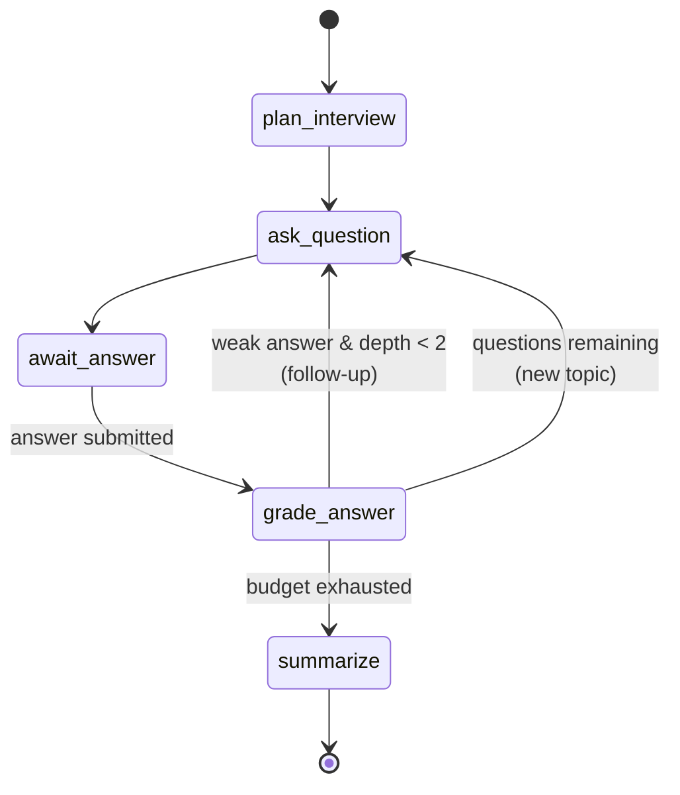

# Mettle

**AI mock interviews for mobile/Flutter engineers.** Pick a topic, get interviewed by an agent that
probes deeper when an answer is thin, and get a rubric-scored breakdown with your progress tracked
over time.

Flutter app (Android · Web) + FastAPI/LangGraph backend in one repo.

> The differentiator is **measurement, not chat**. Anything can ask questions. This scores answers
> against a fixed rubric and shows the trend across sessions.

<!-- Demo GIF goes here once M1 ships — top of the README, before anything else. -->

---

## 🚧 Status

**In active development — M1 in progress.** This README documents the architecture as designed and
agreed; the sections below mark what is implemented versus planned so nothing here overstates what
you'll find if you clone it.

| Milestone | Scope | Status |
|---|---|---|
| **M1** | Splash · Home · Interview · Scorecard · Progress (basic) · Settings (basic). Text only, no auth, difficulty-tiered topics, end to end | 🚧 In progress |
| **M2** | Auth · onboarding (stack · experience · focus) · personalised Home · voice answers + waveform · progress filters | ⬜ Planned |
| **M3** | Multi-stack catalogues · JD-targeted questions · checkpointer resume · human-in-the-loop · deployed web build | ⬜ Planned |

Design docs are checked in and current: [product & UI plan](docs/product-plan.md) ·
[backend architecture](docs/backend-plan.md) · [Flutter conventions](CONVENTIONS.md).

---

## Phase 1 scope

One repository, two deployable apps, one working vertical slice between them.

**Definition of done:** `docker compose up` plus `flutter run` completes a full interview — question,
answer, follow-up, scorecard — on a real device against a live model. Not "the UI is finished" or
"the graph works" — the two halves meeting. **Verified**: an Android device over Wi-Fi driving the
containerised backend end to end.

| | Ships in Phase 1 |
|---|---|
| **`app/`** | Splash → Home → setup sheet → Interview → Scorecard, plus basic Progress and Settings tabs. Text only. Design tokens and both themes before any screen. All four states on every screen. Responsive for phone and web. |
| **`api/`** | The versioned SSE event protocol, the five-node graph with the conditional follow-up edge, SQLite checkpointer (Postgres-ready), the topic catalogue, and the provider adapter. |
| **The seam** | The SSE event protocol is the contract, and the Dart `TurnEvent` sealed class is its client-side shape. Both halves are versioned together in one repo, so a change to the protocol is one commit. |
| **CI** | Two workflows green with no secrets configured, including the dependency-rule guard and the iOS compile check. |

**Why a monorepo matters specifically now:** in Phase 1 the SSE contract changes constantly, and
every change touches both sides. Here that's one commit and one PR that either passes both workflows
or doesn't. Split across two repos, every contract tweak becomes a coordinated two-repo dance with a
window where `main` is broken on one side. This matters much less by M3 — it matters a lot today.

**Explicitly out of scope for Phase 1:** voice input · question coverage · progress filters and date
ranges · a configurable API URL · accounts · notifications · role/JD onboarding · auth · Postgres ·
iOS device testing · running without an API key.

Progress and Settings **are** in Phase 1, in their basic form — the list above is what gets cut from
them, not the screens themselves. Both are cheap on top of what already exists: Progress reads the
same local sessions Home does and reuses the sparkline painter, and Settings needs nothing beyond
the `shared_preferences` instance the app already registers.

Naming that list is what keeps Phase 1 finishable. Ships as tag **`v0.1.0`** with a changelog entry.

---

## Platform support — and why iOS is untested

| Target | Status | Notes |
|---|---|---|
| **Android** | ✅ Primary, developed and tested | Main development target |
| **Web** | ✅ Primary | Built with `--wasm`; the public demo surface |
| **iOS** | ⚠️ **Compile-verified in CI only — not device-tested** | See below |
| Desktop | ❌ Not a target | Cost without payoff for this product |

**On iOS, specifically:** the codebase is platform-agnostic Dart with no Android-only dependencies,
and CI runs `flutter build ios --no-codesign` so regressions in iOS compilation get caught. But I
develop on a **Windows laptop**, and iOS builds require macOS and Xcode — my office Mac isn't
available for personal project work. So iOS has never been run on a simulator or a device by me.

I'd rather state that plainly than list iOS as "supported" and have you discover it doesn't launch.
If you have a Mac and want to try it, I'd genuinely welcome the issue report.

One deliberate consequence: **voice input (M2) degrades to text on web.** Microphone permissions and
codec support differ enough across browsers that designing the fallback was the right call rather
than shipping a mic button that silently fails.

---

## Why there's no login screen *yet*

**There is no authentication in M1** — no signup, no password reset, no OAuth. Splash goes straight
to Home on every launch. **M2 adds sign-in and onboarding**; this section is why it ships second
rather than first, and the ordering is deliberate:

- **Identity is device-local.** Sessions and scores live in a local database on the device. There's
  no account to create and nothing lost by not having one.
- **The API needs no user table, no JWT, no refresh-token flow, no session middleware.** It accepts
  an anonymous device id whose only job is scoping a LangGraph checkpoint thread. That's the entire
  identity story — it partitions data, it doesn't authenticate anyone, and the code says so.
- **Zero friction to try it.** Open the web demo and you're interviewing in seconds. An auth wall in
  front of a demo app loses most of its visitors.
- **It's where the interesting work isn't.** CRUD-plus-login is the most commonly built portfolio
  project there is. Skipping it spent that time on the streaming UI, the agent graph, and the scoring
  rubric instead.

**M2 adds accounts, a first-run flow, and a Home personalised to your stack and experience level** —
layered on top of working local storage rather than placed as a gate in front of it. The sequencing is
the point: local storage already works, so an account becomes a sync mechanism rather than a
prerequisite, and the onboarding flow stays skippable with defaults that work.

---

## What it does

| Screen | Purpose |
|---|---|
| **Splash** | Real async bootstrap — DI, local DB, prefs, device id — then replaces itself with Home. No artificial delay. |
| **Home** | Average-score ring, score sparkline, recent sessions, weak-topic chips, start CTA |
| **Interview** | The core loop: streaming questions, `Q 3 of 5` progress, answer input, and a **`↳ FOLLOW-UP`** badge when the agent decides to probe deeper instead of advancing |
| **Scorecard** | Per-dimension rubric scores (correctness · depth · clarity · structure), overall ring, what was missing, next steps |
| **Progress** | Score trend across your last 10 sessions, topic mastery rows with average and band, and a session history that opens any past scorecard |
| **Settings** | Appearance (system · light · dark), a read-only demo-mode row, clear stored data behind a confirmation, and app version |
| History filters · coverage · API endpoint | M2 — the parts of Progress and Settings deliberately cut from Phase 1 |

Every screen implements all four states — loading, empty, error, loaded — not just the happy path.
Skeletons, never centered spinners.

---

## Architecture — Flutter app

**Clean Architecture** with a strict dependency rule: `presentation → domain ← data`. The domain
layer imports nothing from `data`, `presentation`, or Flutter itself, and CI fails the build if it
does.

```
lib/
├── core/           constants · theme · error · network · router · di · result
└── features/<feature>/
    ├── data/           models · datasources · repositories (impl)
    ├── domain/         entities · repository contracts · use cases
    └── presentation/   bloc · pages · widgets
```

| Concern | Choice |
|---|---|
| State management | `flutter_bloc` — one bloc per feature, sealed states, `Cubit` where there are no meaningful events |
| Dependency injection | `get_it`, manual registration in one file — explicit and greppable, no codegen |
| Navigation | `go_router` with `StatefulShellRoute`; navigate by name, pass IDs not objects |
| Error handling | A hand-rolled sealed `Result<T>` + Dart 3 pattern matching — no `dartz`, no extra dependency |
| Theming | Material 3, light + dark from one seed, built before the first screen |

Two conventions worth calling out, both documented in [`CONVENTIONS.md`](CONVENTIONS.md):

- **No `build_runner` codegen** — no `freezed`, `injectable`, or `json_serializable` while the app is
  small. Dart 3 sealed classes cover it without a build step. This was the single biggest lever on
  keeping the codebase pleasant to work in.
- **`Page` / `View` split** — `*Page` is the route boundary that reads DI and provides the bloc;
  `*View` is pure UI with no dependencies, which is what makes it widget-testable. `sl<T>()` appears
  in exactly one place per feature.

---

## Architecture — backend

FastAPI + LangGraph. **The graph is the product**: an interview is a genuine state machine, which is
why LangGraph earns its place here rather than being bolted onto a single prompt.



Three LangGraph features, each doing real work:

- **A conditional edge** routes on grade — probe deeper on a weak answer (capped at depth 2), else
  advance, else summarize. It's about six lines, and it's the thing worth reading in the whole repo.
- **`interrupt()`** parks the graph while waiting for the user's answer.
- **A checkpointer** (SQLite → Postgres) persists state, so a session resumes days later.

That routing decision travels to the client as a first-class SSE event, which is what makes the
`↳ FOLLOW-UP` badge in the UI truthful rather than cosmetic.

### HTTP surface

```
POST /v1/sessions                     create a session
GET  /v1/sessions/{id}/turns/stream   SSE — question tokens + grade events
POST /v1/sessions/{id}/answer         submit an answer (idempotent on turn_id)
GET  /v1/sessions/{id}/scorecard      final scorecard
GET  /v1/meta                         version · model · demo_mode
```

Answer submission and streaming are **separate calls** on purpose: a POST returning
`text/event-stream` is more elegant, but `EventSource` on the web is GET-only, and web is a primary
target. Two cheap round-trips beat a platform-specific transport.

### The provider seam

The model sits behind an `LLMProvider` protocol — `stream_question` and `grade` — so the graph never
imports the SDK and knows nothing about which model answers. Swapping models is one env var, and the
provider adapts to each model's capabilities: `effort` and adaptive thinking are sent to Sonnet and
omitted for Haiku, which rejects both.

**There is one implementation, and it needs a key.** An earlier design had a second, scripted
provider reading from a checked-in question bank so the repo would run with no credentials. That was
dropped once topics became difficulty-tiered: a hand-written bank covering 20 topics × 3 levels would
have been large, stale, and graded by keyword matching far weaker than the rubric. The tradeoff is
deliberate and it has a real cost — a reviewer cannot run this without their own key.

### Cost

Measured per call on the live API, with the rubric cached:

| | per grade call | per ~8-turn session | per $1 |
|---|---|---|---|
| `claude-haiku-4-5` | ~$0.002 | ~$0.025 | ~40 sessions |
| `claude-sonnet-5` | ~$0.011 | ~$0.12 | ~8 sessions |

Sonnet's cost is dominated by thinking tokens on grading, which is `GRADE_EFFORT` doing its job —
lowering it to `medium` is a bigger lever than switching model. Haiku is far cheaper but grades more
leniently, and since a lenient score means fewer follow-ups fire, it slightly weakens the probe loop.

The rubric is byte-identical every turn, so it is cached behind one breakpoint: **1771 tokens written
once, then read at ~10% cost on every later call**. Mind the per-model floor — a prefix under it
silently never caches (512 tokens on Opus 5, **1024 on Sonnet 5**, 4096 on Haiku 4.5).

### Model usage

Schema-validated structured output against a Pydantic score model — no JSON coaxing or
retry-on-parse loops. Adaptive reasoning with `effort` as the quality/latency dial. The rubric is
byte-identical every turn, so one prompt-cache breakpoint makes a session pay for it once instead of
per question. Refusals are handled explicitly — someone practising for a **security** role asks for
security questions, which can legitimately trip safety classifiers, so that path falls back rather
than dead-ending mid-interview.

---

## Quick start

> **An Anthropic API key is required.** Every question is written and every answer graded by a live
> model, so there is no offline or canned mode — without a key the backend starts but
> `POST /v1/sessions` returns `503`. Interviews cost roughly **2–12 cents each** depending on the
> model (see [Cost](#cost)).

### 1. Configure the key

```bash
cp .env.example .env
```

Then edit `.env` and set your key:

```ini
ANTHROPIC_API_KEY=sk-ant-...
ANTHROPIC_MODEL=claude-haiku-4-5    # or claude-sonnet-5 for stronger grading
```

Leave `LLM_PROVIDER` commented out — the backend selects the live provider automatically when a key
is present. `.env` is gitignored; never commit it, and never pass it to `--dart-define-from-file`
(those values are compiled into the app binary).

### 2. Run the backend

```bash
docker compose up -d          # http://localhost:8000
curl localhost:8000/v1/meta   # expect "demo_mode":false and your model
```

Without Docker:

```bash
cd api && uv sync && uv run uvicorn app.main:app --port 8000
```

Run **one instance with one worker** — session state and the SSE queue live in process memory, so a
second worker breaks the answer/stream pairing. `docker compose down` stops it.

### 3. Run the app

**Android emulator** — `10.0.2.2` is the emulator's alias for your host:

```bash
cd app && flutter run --dart-define-from-file=dart_defines/emulator.json
```

**Real device over USB** — `adb reverse` tunnels the phone's own `localhost` to your machine, which
survives changing networks and needs no firewall rule:

```bash
adb reverse tcp:8000 tcp:8000
cd app && flutter run --dart-define-from-file=dart_defines/device.json
```

**Real device over Wi-Fi** — needed if you want to unplug the cable. Both devices must be on the same
network, and the backend must be reachable from it:

```bash
cp app/dart_defines/local.json.example app/dart_defines/local.json
# edit local.json and put your machine's LAN IP in METTLE_BASE_URL
cd app && flutter run --dart-define-from-file=dart_defines/local.json
```

On Windows, allow the port once (PowerShell as Administrator):

```powershell
New-NetFirewallRule -DisplayName "Mettle API" -Direction Inbound -Protocol TCP `
  -LocalPort 8000 -Action Allow -Profile Private -RemoteAddress LocalSubnet
```

`local.json` is gitignored, since the IP is specific to your machine. Note the LAN address is baked in
at build time, so it must be rebuilt if your router hands out a different IP.

### Notes

- `METTLE_BASE_URL` is a **compile-time** constant. Changing it needs a restart, not a hot reload.
- Plain HTTP to a LAN address only works in **debug** builds. Release builds are HTTPS-only by
  design, so a release APK needs a deployed backend.
- Interviews need the backend running. Home, Progress, Settings and past scorecards read device-local
  storage and work with it switched off.

---

## Repository layout

```
├── app/              Flutter application          ✅ in place
│   ├── lib/core/         constants · theme · result · error · router · di · storage · widgets
│   ├── lib/features/     splash · home · interview · progress · settings
│   └── test/             mirrors lib/
├── api/              FastAPI + LangGraph service  ✅ in place
├── docs/             product plan · backend architecture
├── CONVENTIONS.md    Flutter conventions (binding, enforced in review)
└── docker-compose.yml                             ✅ in place
```

Platform targets are `android`, `ios`, and `web` only — the desktop platform
folders are deliberately absent rather than carried along unused.

---

## Testing & CI

| Layer | Tooling | Asserts |
|---|---|---|
| Graph routing | pytest | **A weak answer routes to a follow-up; a strong one advances** — the most important test in the repo |
| Graph resume | pytest | Interrupt, rebuild from checkpointer, continue with state intact |
| API routes | `httpx.AsyncClient` | Contract + SSE event names and ordering |
| Use cases / repositories | `mocktail` | Exception → `Failure` mapping, cache fallback |
| Blocs | `bloc_test` | Exact emitted state sequence, success and failure paths |
| Widgets | `flutter_test` | Each sealed state renders correctly |
| Key screens | golden tests | Light + dark × compact + expanded |

CI makes **no network calls** and needs **no secrets**: `flutter analyze --fatal-infos`,
`dart format --set-exit-if-changed`, `flutter test`, `ruff`, `mypy --strict`, `pytest`, plus the
dependency-rule guard and the iOS compile check.

---

## Roadmap

- **M1** — complete text-only loop, difficulty-tiered topics, basic Progress and Settings
- **M2** — accounts and onboarding (stack · experience · focus), a personalised Home, voice answers
  with a custom-painted waveform, progress filters
- **M3** — catalogues for the remaining stacks, job-description targeting, session resume, deployed
  web demo
- **v2** — cross-device sync on top of M2's accounts, team or cohort features

---

## License

MIT
