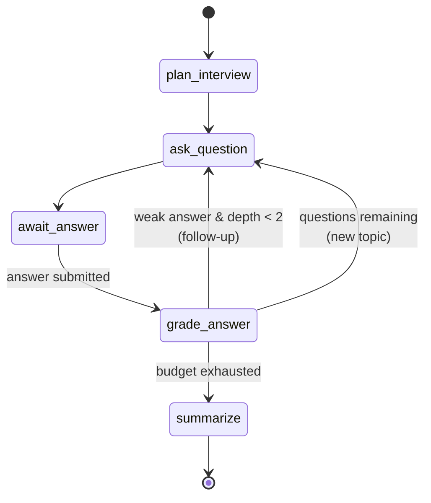

# Mettle

**AI mock interviews for mobile/Flutter engineers.** Pick a topic, get interviewed by an agent that
probes deeper when an answer is thin, and get a rubric-scored breakdown with your progress tracked
over time.

Flutter app (Android · Web) + FastAPI/LangGraph backend in one repo.

> The differentiator is **measurement, not chat**. Anything can ask questions. This scores answers
> against a fixed rubric and shows the trend across sessions.

<!-- Demo GIF goes here once M1 ships — top of the README, before anything else. -->

---

## 🚧 Status

**In active development — M1 in progress.** This README documents the architecture as designed and
agreed; the sections below mark what is implemented versus planned so nothing here overstates what
you'll find if you clone it.

| Milestone | Scope | Status |
|---|---|---|
| **M1** | Splash · Home · Interview · Scorecard. Text only, no auth, keyless demo mode, end to end | 🚧 In progress |
| **M2** | Voice answers + waveform, Progress charts, History, Settings, offline via Drift | ⬜ Planned |
| **M3** | Rubric evaluation, role/JD setup, checkpointer resume, human-in-the-loop, deployed web build | ⬜ Planned |

Design docs are checked in and current: [product & UI plan](docs/product-plan.md) ·
[backend architecture](docs/backend-plan.md) · [Flutter conventions](CONVENTIONS.md).

---

## Phase 1 scope

One repository, two deployable apps, one working vertical slice between them.

**Definition of done:** `docker compose up` plus `flutter run` completes a full interview — question,
answer, follow-up, scorecard — with **no API key configured**. Not "the UI is finished" or "the graph
works" — the two halves meeting.

| | Ships in Phase 1 |
|---|---|
| **`app/`** | Splash → Home → setup sheet → Interview → Scorecard. Text only. Design tokens and both themes before any screen. All four states on every screen. Responsive for phone and web. |
| **`api/`** | Five endpoints, the versioned SSE event protocol, the five-node graph with the conditional follow-up edge, SQLite checkpointer, `ScriptedProvider` as the default. |
| **The seam** | The SSE event protocol is the contract. The app builds against fakes, the API against its scripted provider — both test it independently, so neither side blocks the other. |
| **CI** | Two workflows green with no secrets configured, including the dependency-rule guard and the iOS compile check. |

**Why a monorepo matters specifically now:** in Phase 1 the SSE contract changes constantly, and
every change touches both sides. Here that's one commit and one PR that either passes both workflows
or doesn't. Split across two repos, every contract tweak becomes a coordinated two-repo dance with a
window where `main` is broken on one side. This matters much less by M3 — it matters a lot today.

**Explicitly out of scope for Phase 1:** voice input · progress charts · history · settings ·
role/JD onboarding · auth · Postgres · iOS device testing · real model calls as the default path
(the hosted provider works, but scripted is the default so the repo stays keyless).

Naming that list is what keeps Phase 1 finishable. Ships as tag **`v0.1.0`** with a changelog entry.

---

## Platform support — and why iOS is untested

| Target | Status | Notes |
|---|---|---|
| **Android** | ✅ Primary, developed and tested | Main development target |
| **Web** | ✅ Primary | Built with `--wasm`; the public demo surface |
| **iOS** | ⚠️ **Compile-verified in CI only — not device-tested** | See below |
| Desktop | ❌ Not a target | Cost without payoff for this product |

**On iOS, specifically:** the codebase is platform-agnostic Dart with no Android-only dependencies,
and CI runs `flutter build ios --no-codesign` so regressions in iOS compilation get caught. But I
develop on a **Windows laptop**, and iOS builds require macOS and Xcode — my office Mac isn't
available for personal project work. So iOS has never been run on a simulator or a device by me.

I'd rather state that plainly than list iOS as "supported" and have you discover it doesn't launch.
If you have a Mac and want to try it, I'd genuinely welcome the issue report.

One deliberate consequence: **voice input (M2) degrades to text on web.** Microphone permissions and
codec support differ enough across browsers that designing the fallback was the right call rather
than shipping a mic button that silently fails.

---

## Why there's no login screen

**There is no authentication in v1** — no signup, no password reset, no OAuth. Splash goes straight
to Home on every launch. This is a deliberate scope decision, and the consequences run all the way
down the stack:

- **Identity is device-local.** Sessions and scores live in a local database on the device. There's
  no account to create and nothing lost by not having one.
- **The API needs no user table, no JWT, no refresh-token flow, no session middleware.** It accepts
  an anonymous device id whose only job is scoping a LangGraph checkpoint thread. That's the entire
  identity story — it partitions data, it doesn't authenticate anyone, and the code says so.
- **Zero friction to try it.** Open the web demo and you're interviewing in seconds. An auth wall in
  front of a demo app loses most of its visitors.
- **It's where the interesting work isn't.** CRUD-plus-login is the most commonly built portfolio
  project there is. Skipping it spent that time on the streaming UI, the agent graph, and the scoring
  rubric instead.

**v2 adds accounts and cross-device sync** — layered on top of working local storage rather than
placed as a gate in front of it, so the app keeps working offline and the demo stays frictionless.

---

## What it does

| Screen | Purpose |
|---|---|
| **Splash** | Real async bootstrap — DI, local DB, prefs, device id — then replaces itself with Home. No artificial delay. |
| **Home** | Average-score ring, score sparkline, recent sessions, weak-topic chips, start CTA |
| **Interview** | The core loop: streaming questions, `Q 3 of 5` progress, answer input, and a **`↳ FOLLOW-UP`** badge when the agent decides to probe deeper instead of advancing |
| **Scorecard** | Per-dimension rubric scores (correctness · depth · clarity · structure), overall ring, what was missing, next steps |
| Progress · History · Settings | M2 — trends, past sessions, configurable API endpoint |

Every screen implements all four states — loading, empty, error, loaded — not just the happy path.
Skeletons, never centered spinners.

---

## Architecture — Flutter app

**Clean Architecture** with a strict dependency rule: `presentation → domain ← data`. The domain
layer imports nothing from `data`, `presentation`, or Flutter itself, and CI fails the build if it
does.

```
lib/
├── core/           constants · theme · error · network · router · di · result
└── features/<feature>/
    ├── data/           models · datasources · repositories (impl)
    ├── domain/         entities · repository contracts · use cases
    └── presentation/   bloc · pages · widgets
```

| Concern | Choice |
|---|---|
| State management | `flutter_bloc` — one bloc per feature, sealed states, `Cubit` where there are no meaningful events |
| Dependency injection | `get_it`, manual registration in one file — explicit and greppable, no codegen |
| Navigation | `go_router` with `StatefulShellRoute`; navigate by name, pass IDs not objects |
| Error handling | A hand-rolled sealed `Result<T>` + Dart 3 pattern matching — no `dartz`, no extra dependency |
| Theming | Material 3, light + dark from one seed, built before the first screen |

Two conventions worth calling out, both documented in [`CONVENTIONS.md`](CONVENTIONS.md):

- **No `build_runner` codegen** — no `freezed`, `injectable`, or `json_serializable` while the app is
  small. Dart 3 sealed classes cover it without a build step. This was the single biggest lever on
  keeping the codebase pleasant to work in.
- **`Page` / `View` split** — `*Page` is the route boundary that reads DI and provides the bloc;
  `*View` is pure UI with no dependencies, which is what makes it widget-testable. `sl<T>()` appears
  in exactly one place per feature.

---

## Architecture — backend

FastAPI + LangGraph. **The graph is the product**: an interview is a genuine state machine, which is
why LangGraph earns its place here rather than being bolted onto a single prompt.



Three LangGraph features, each doing real work:

- **A conditional edge** routes on grade — probe deeper on a weak answer (capped at depth 2), else
  advance, else summarize. It's about six lines, and it's the thing worth reading in the whole repo.
- **`interrupt()`** parks the graph while waiting for the user's answer.
- **A checkpointer** (SQLite → Postgres) persists state, so a session resumes days later.

That routing decision travels to the client as a first-class SSE event, which is what makes the
`↳ FOLLOW-UP` badge in the UI truthful rather than cosmetic.

### HTTP surface

```
POST /v1/sessions                     create a session
GET  /v1/sessions/{id}/turns/stream   SSE — question tokens + grade events
POST /v1/sessions/{id}/answer         submit an answer (idempotent on turn_id)
GET  /v1/sessions/{id}/scorecard      final scorecard
GET  /v1/meta                         version · model · demo_mode
```

Answer submission and streaming are **separate calls** on purpose: a POST returning
`text/event-stream` is more elegant, but `EventSource` on the web is GET-only, and web is a primary
target. Two cheap round-trips beat a platform-specific transport.

### It runs without an API key

The model sits behind an `LLMProvider` protocol with two implementations — a real hosted-model
one and a **deterministic scripted one** that reads from a question bank and grades by rubric
coverage. The scripted provider is the default whenever no API key is present, so:

- `docker compose up` gives a reviewer a working app in 30 seconds with no credentials
- CI runs the full suite — including graph routing tests — with no secrets and no flake
- The app's demo mode is this same code path, not a separate mock

### Model usage

Schema-validated structured output against a Pydantic score model — no JSON coaxing or
retry-on-parse loops. Adaptive reasoning with `effort` as the quality/latency dial. The rubric is
byte-identical every turn, so one prompt-cache breakpoint makes a session pay for it once instead of
per question. Refusals are handled explicitly — someone practising for a **security** role asks for
security questions, which can legitimately trip safety classifiers, so that path falls back rather
than dead-ending mid-interview.

---

## Quick start

Lands with M1 — two commands, no credentials needed.

```bash
# Backend (scripted provider, no API key required)
docker compose up

# App
cd app && flutter run          # Android
cd app && flutter run -d chrome # Web
```

To use real model calls, copy `.env.example` to `.env` and fill in your provider API key. The app's
**Settings** screen (M2) also lets you point it at your own backend URL.

---

## Repository layout

Moving to a monorepo as part of M1 scaffolding:

```
├── app/              Flutter application
├── api/              FastAPI + LangGraph service
├── docs/             product plan · backend architecture
├── CONVENTIONS.md    Flutter conventions (binding, enforced in review)
└── docker-compose.yml
```

---

## Testing & CI

| Layer | Tooling | Asserts |
|---|---|---|
| Graph routing | pytest | **A weak answer routes to a follow-up; a strong one advances** — the most important test in the repo |
| Graph resume | pytest | Interrupt, rebuild from checkpointer, continue with state intact |
| API routes | `httpx.AsyncClient` | Contract + SSE event names and ordering |
| Use cases / repositories | `mocktail` | Exception → `Failure` mapping, cache fallback |
| Blocs | `bloc_test` | Exact emitted state sequence, success and failure paths |
| Widgets | `flutter_test` | Each sealed state renders correctly |
| Key screens | golden tests | Light + dark × compact + expanded |

CI makes **no network calls** and needs **no secrets**: `flutter analyze --fatal-infos`,
`dart format --set-exit-if-changed`, `flutter test`, `ruff`, `mypy --strict`, `pytest`, plus the
dependency-rule guard and the iOS compile check.

---

## Roadmap

- **M1** — complete text-only loop, keyless demo mode
- **M2** — voice answers with a custom-painted waveform, progress charts, offline-first storage
- **M3** — full rubric evaluation, role + job-description targeting, session resume, deployed web demo
- **v2** — accounts and cross-device sync (layered over local storage, not a gate in front of it)

---

## License

MIT
