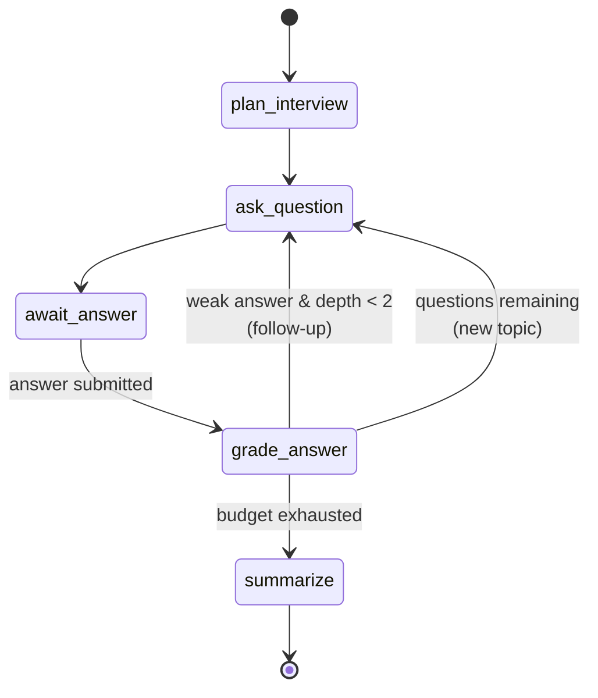

# Mettle — Backend Architecture

FastAPI + LangGraph service backing the Flutter app. Companion to
[`product-plan.md`](./product-plan.md); Flutter conventions in [`../CONVENTIONS.md`](../CONVENTIONS.md).

**Design goal:** the graph is the product. A reviewer should be able to read `graph/build.py` and see
the interview logic in twenty lines. Running it needs an Anthropic key — see §4 for why that trade
was made.

---

## 1. Stack

| Concern | Choice | Why |
|---|---|---|
| Web framework | FastAPI, async throughout | SSE streaming, Pydantic v2 validation, DI via `Depends` |
| Agent runtime | LangGraph `StateGraph` | Conditional edges + checkpointer + `interrupt()` are exactly this problem |
| Model | A frontier hosted LLM, reached through the provider adapter | Grading quality *is* the product; the effort dial is the cost lever, not a model downgrade |
| Checkpoints | `AsyncSqliteSaver` (dev) → `AsyncPostgresSaver` (prod) | Durable resume, swap by env var |
| Read models | SQLite / Postgres, 2 tables | Checkpoints are opaque blobs — you can't query "my last 10 sessions" from them |
| Deps / tooling | `uv`, `ruff`, `mypy --strict`, `pytest` | Fast, no Poetry ceremony |

---

## 2. The graph

An interview is a genuine state machine, which is the whole reason LangGraph earns its place here:
ask → listen → *either probe deeper or move on* → grade → summarize. That branch is a conditional
edge, the pause for an answer is an `interrupt()`, and the resume-after-days is a checkpointer.



### State

```python
class InterviewState(TypedDict):
    session_id: str
    topic: str                   # "concurrency" — resolves to a label + difficulty
    difficulty: str              # "easy" | "medium" | "hard"
    question_total: int
    questions_remaining: int
    asked_count: int
    history: list[Turn]          # question + answer + score
    pending: PendingQuestion | None   # awaiting an answer
    follow_up_depth: int         # 0..2 — hard cap on probing
    follow_up_reason: str | None # the weakest dimension, drives the probe
    probe: bool                  # the routing decision, taken in grade_answer
    scorecard: dict | None
```

### Nodes

| Node | Does |
|---|---|
| `plan_interview` | Chooses question areas from role + seniority + topic. Runs once. |
| `ask_question` | Generates the next question — or a follow-up conditioned on the weak dimension of the last answer. Streams tokens out. |
| `await_answer` | `interrupt()`. The graph parks here; the checkpointer persists everything. |
| `grade_answer` | Scores against the rubric via structured output → `TurnScore`. |
| `summarize` | Aggregates turns into a `Scorecard` with per-dimension totals and weak topics. |

### The conditional edge — the one piece of logic that matters

```python
def route_after_grade(state: InterviewState) -> str:
    last = state["history"][-1].score
    if last.weakest_dimension_score <= 2 and state["follow_up_depth"] < 2:
        return "ask_question"        # probe deeper, same topic
    if state["questions_remaining"] > 0:
        return "ask_question"        # advance
    return "summarize"
```

**This function is the project.** It's what makes the `↳ FOLLOW-UP` badge in the UI truthful, it's
what you point at when asked "why a graph and not one prompt?", and it's the thing a reviewer can
understand in ten seconds. Keep it this small.

`graph.get_graph().draw_mermaid()` renders the diagram above — generate it in CI and commit it so the
README's diagram can never drift from the code.

---

## 3. HTTP surface

```
POST   /v1/sessions                      create → {session_id, first_turn_url}
GET    /v1/sessions/{id}                 full state (cold reconnect, history)
GET    /v1/sessions/{id}/turns/stream    SSE: question tokens + grade events
POST   /v1/sessions/{id}/answer          submit answer → 202
POST   /v1/sessions/{id}/skip            skip current question → 202
GET    /v1/sessions/{id}/scorecard       final scorecard
GET    /v1/topics                        the difficulty-tiered topic catalogue
GET    /v1/meta                          {version, model, demo_mode, configured}
GET    /healthz                          liveness + provider + checkpointer
```

### Why answer-submit and streaming are separate calls

`POST /answer` returns `202` immediately; the client then opens `GET /turns/stream` for the next
question's tokens. A single `POST` that returns `text/event-stream` would be more elegant and is
tempting — but `EventSource` on the web only does GET, so a POST stream forces a `fetch`-based HTTP
client on Flutter web. Two cheap round-trips beat a platform-specific transport on a primary target.

`POST /answer` takes a client-generated `turn_id` and is **idempotent** — a mobile retry after a
dropped connection can't double-submit an answer.

### SSE event protocol (versioned — the Flutter app depends on this)

```
event: turn.started     data: {"index":3,"total":5,"kind":"follow_up","reason":"depth","topic":"concurrency"}
event: question.delta   data: {"text":"What actually "}
event: question.done    data: {"question_id":"q-2-1","text":"…","index":3,"total":5,"kind":"follow_up","reason":"depth"}
event: grade.started    data: {}
event: grade.done       data: {"correctness":3,"depth":2,"clarity":4,"structure":3,"missing":["…"],"notes":"…"}
event: session.done     data: {"scorecard_url":"/v1/sessions/…/scorecard"}
event: error            data: {"code":"graph_failed","message":"…","retryable":true}
```

Named events with typed payloads, not a bag of JSON on a single channel. **`turn.started` carrying
`kind: "follow_up"` and the `reason` is what drives the badge on the Interview screen** — the graph's
routing decision travels over the wire as a first-class event rather than being inferred client-side.

**The client-side shape is the spec.** Every payload above exists to deconstruct cleanly into the
Dart sealed class in `app/.../entities/turn_event.dart`, which is the real contract. Four fields are
easy to leave out and each breaks something specific:

| Field | Without it |
|---|---|
| `index` + `total` on `turn.started` | The `Q 3 of 5` counter has nothing to render |
| `index`/`total`/`kind` on `question.done` | `Question` can't be constructed without the client holding state across events |
| `missing` on `grade.done` | The scorecard's "what was missing" and the weak-topic chips are empty |
| `message` on `error` | The UI has a code and no sentence to show a human |

`reason` must be one of `depth` / `correctness` / `clarity` / `structure` — the Dart
`FollowUpReason` enum has no other values, and an unrecognised one silently degrades to no badge.

---

## 4. The provider abstraction

```python
class LLMProvider(Protocol):
    def stream_question(self, req: QuestionRequest) -> AsyncIterator[str]: ...
    async def grade(self, req: GradeRequest) -> TurnScore: ...
```

Two methods, and the graph never imports the SDK. `nodes.py` asks for a question and a score; it has
no idea which model answers, what the prompt looks like, or that caching exists. That is what makes
the routing logic readable on its own.

There is **one implementation**, `AnthropicProvider`, and it requires a key.

### Why there is no scripted provider

The original design had a second, deterministic implementation reading from a checked-in
`questions.yaml` and grading by keyword coverage, so the repo would run with no credentials. It was
built, shipped, and then deleted. Three reasons, in order of weight:

1. **Difficulty tiers made the bank untenable.** 20 topics × 3 levels is a hand-written corpus that
   would be perpetually thin and perpetually stale.
2. **Keyword grading actively lied.** It scored `correctness` by substring hits, so a wrong answer
   containing the right word scored well and a right answer phrased differently scored badly. On a
   product whose thesis is "measurement, not chat," a fake grader is worse than no grader.
3. **It hid a real bug.** The graph fetched keywords from the scripted bank *regardless of which
   provider was live*, so live grading was being handed concepts belonging to a different question.
   Deleting the bank deleted the bug class, not just the bug.

The cost is real and worth stating plainly: a reviewer cannot run this repo without their own API
key. That is a deliberate trade of reviewer convenience for grading that means something.

### What the provider does carry

Model capability differences live here, not in the graph:

| Concern | Handling |
|---|---|
| `effort` + adaptive thinking | Sent to Sonnet-class models; **omitted for Haiku 4.5**, which rejects both with a 400 |
| Question generation | `thinking: disabled` at low effort — thinking-on stalls the token stream behind a silent pause |
| Grading | Adaptive thinking at high effort, schema-validated structured output |
| Rubric caching | One breakpoint on the system block; **mind the per-model floor** (§5) |
| Refusals | `stop_reason` checked before reading `content`, with server-side fallbacks opted in |

---

## 5. Working with the model

**Structured output for grading.** The provider's schema-validated parse path, handed a Pydantic
`TurnScore`, validates the response for you — no JSON coaxing, no retry-on-parse loop, no
assistant-prefill tricks.

```python
class TurnScore(BaseModel):
    correctness: int   # 1-5
    depth: int
    clarity: int
    structure: int
    missing: list[str]
    notes: str
```

**Reasoning is on by default — tune it with effort, not a token budget.** The target model tier
reasons adaptively without configuration; the `effort` dial is the quality/latency control. Start
`high` for grading (it's the product) and `medium` for question generation (latency is user-visible
there), then sweep against your own saved transcripts. The output-token cap covers reasoning *plus*
visible output, so leave headroom or answers truncate mid-sentence.

**No sampling parameters.** The target tier rejects `temperature`, `top_p`, and `top_k` outright.
Consistency in grading therefore comes from a fixed rubric with explicit per-level anchors — which is
the better mechanism regardless, since `temperature=0` never guaranteed determinism.

**Prompt caching is a large real win here.** The rubric plus system prompt is byte-identical across
every turn and every session, so put the cache breakpoint on the last system block. Guard it: keep
timestamps and session IDs *out* of the system prompt, or the prefix changes per request and nothing
caches.

**Mind the per-model cache floor — it is not uniform.** The minimum cacheable prefix is 512 tokens on
Opus 5 but **1024 on Sonnet 5**, and a prefix under the floor silently does not cache: no error, just
`cache_creation_input_tokens: 0` forever. The first rubric written here measured 483 tokens and
therefore never cached on Sonnet. Expanding it to explicit per-level anchors plus two calibration
examples brought it to 1324 tokens, which both clears the floor and is the mechanism the rubric was
supposed to provide in the first place. Measured on `claude-sonnet-5`: 1771 tokens written on the
first grade call, then read from cache on every subsequent one with ~102 uncached. Assert on
`usage.cache_read_input_tokens` in a provider test rather than trusting that it engaged.

**Handle refusals.** This matters more than it looks: a user practising for a **security** role asks
for security interview questions, which can legitimately trip a provider's safety classifiers. A
refusal arrives as a *successful* HTTP 200 with a refusal stop reason and no usable content — so
branch on the stop reason before reading the body, and configure a fallback model so a declined
request is re-served instead of dead-ending mid-interview.

---

## 6. Persistence

Two stores, each with a clear job:

- **Checkpoints** (`AsyncSqliteSaver` / `AsyncPostgresSaver`), `thread_id = session_id`. Owns live
  graph state and makes resume-after-days free.
- **Read models**, two tables — `sessions` and `turns`. Owns everything the API must *query*:
  history lists, score trends, weak-topic aggregation.

The read model exists because checkpoints are opaque blobs. Without it, rendering the Progress screen
would mean rehydrating N graphs. Two tables is the whole schema — don't let it grow into a second
source of truth for live state.

---

## 7. Identity

No auth, per the product decision. A `X-Device-Id` header carries a client-generated UUID, used only
to scope `thread_id` and the history list. **This is partitioning, not security** — say so in the
README rather than implying it authenticates anyone. No user table, no JWT, no session middleware.

---

## 8. Layout

```
api/
├── app/
│   ├── main.py              app factory, CORS, lifespan
│   ├── config.py            pydantic-settings
│   ├── api/v1/routes.py     thin — validate, call service, return
│   ├── schemas/             wire contract (request/response models)
│   ├── graph/
│   │   ├── state.py
│   │   ├── nodes.py
│   │   ├── rubric.py        the rubric text — one constant, cached
│   │   └── build.py         StateGraph assembly + compile
│   ├── providers/
│   │   ├── base.py          the Protocol + wire models
│   │   ├── anthropic.py     prompts, caching, capability flags
│   │   └── factory.py       one provider, or a clear 503
│   ├── session/             per-session mailbox, worker, SSE fan-out
│   ├── store/checkpointer.py  SQLite or Postgres, chosen by DATABASE_URL
│   └── data/
│       ├── topics.yaml      20 topics across 3 difficulty tiers
│       └── catalog.py       loads and resolves them
├── tests/
├── Dockerfile
└── pyproject.toml
```

Same dependency discipline as the Flutter side: `routes` know nothing about the provider SDK,
`graph` knows only the `LLMProvider` Protocol, and `providers` know nothing about HTTP.

---

## 9. Testing

| Layer | Asserts |
|---|---|
| Graph routing | **A weak answer routes to a follow-up; a strong one advances.** The single most important test in the repo. |
| Graph resume | Interrupt mid-session, rebuild from the checkpointer, continue — state intact |
| Routes | `httpx.AsyncClient` against the app, the provider faked at the Protocol |
| SSE contract | Event names and ordering match §3 — this is what the Flutter client parses |
| Providers | `AnthropicProvider` request-shaping tested against a recorded response; capability flags asserted per model (Haiku must not receive `effort`) |

CI makes **no network calls**. `ruff`, `mypy --strict`, `pytest` all green with zero secrets
configured — which is also what makes the badges meaningful rather than decorative.

---

## 10. Ops

- Multi-stage `Dockerfile` on `uv`; `docker compose up` brings up api + Postgres with seeded data
- `/healthz` liveness, `/v1/meta` exposing version + model + `demo_mode` so the app can show a
  `DEMO MODE` chip truthfully
- CORS restricted to the GitHub Pages origin; HTTPS both ends
- Structured JSON logs with a per-session correlation id; log the provider's `request_id` on failures
- Deploy to Fly.io free tier; GitHub Actions runs lint + types + tests, then builds the image

---

## 11. Build order

1. ✅ Topic catalogue (`topics.yaml` + `catalog.py`) — the vocabulary both halves agree on
2. ✅ State, nodes, and the conditional edge
3. ✅ SQLite checkpointer, plus handle rehydration so a restart resumes mid-interview
4. ✅ FastAPI routes, the SSE event protocol, and the per-session mailbox that joins
   `POST /answer` to the open `GET /turns/stream`
5. ✅ `AnthropicProvider` with structured-output grading and a cached rubric
6. ✅ Docker + compose, verified on a real device over Wi-Fi
7. ⬜ Tests — graph routing first, then the SSE contract
8. ⬜ CI, then deploy

**Step 4 is the one that bites.** The request that resumes the graph is not the request that streams
the result back, because `EventSource` is GET-only on web. A per-session `asyncio.Queue` and a single
consumer worker join them, which is also why this runs as **one instance with one worker** — the
mailbox is process memory. Moving it to Redis is the price of horizontal scaling, and the Postgres
checkpointer does not buy it for you.
